# Parc Launcher



A calm home screen for Android. Your apps sit on arcs that sweep up from the
bottom-right corner, under your thumb. Aim with the joystick, release to open.
There is no app grid, no feed and no internet permission (a separate, optional
weather build adds that one permission for the Weather page; see below).

Parc is a personal project, shared as open source. It is designed for a phone
held in the right hand, in portrait, at about 384 x 853 dp.





## What it does

- **Arcs and a joystick.** Pinned apps sit on the inner arcs, folders on the
  outer ones. Drag from the hub to aim, release to open. Pinned slots stay where
  you put them.
- **Folders you can edit.** Create, rename, reorder, add and remove apps.
- **Search.** Pull down from the home screen, or use the handle. Search finds
  apps, folders and Settings pages, plus optional contacts, calendar events and
  media file names when you allow them.
- **All apps.** An A to Z list is always one tap away.
- **Hidden apps.** Keep an app out of the arcs, search and the list.
- **Stats hub.** Swipe sideways for Clock, System, Power, Network, Apps, Sound,
  Timers, Agenda, Media, Focus, Messages and Notes. Quick toggles (off until you
  add it) switches the torch and Do Not Disturb and opens the Wi-Fi, Bluetooth,
  mobile data, airplane mode, auto-rotate, battery saver and screen timeout
  screens, because Android does not let apps switch those directly.
- **Skins.** Midnight (default), Dusk, Cyber, Field Atlas Light, Field Atlas
  Dark and Phosphor. A wallpaper skin follows the system wallpaper colours, and
  the skin editor lets you make and keep your own.
- **Notification badges.** Unread dots on icons, if you turn them on.
- **Messages page.** Read and dismiss messages from the hub, with optional quick
  replies, when you grant notification access.
- **Focus modes.** A gentle pause before distracting apps, optional quiet
  badges and messages, and an optional Do Not Disturb rule for the mode.
- **Locked folders.** Open a folder with your screen lock or fingerprint.
- **Backup and restore.** Save your layout, settings and notes to a file you
  choose, and restore it later.
- **Safe mode.** If Parc crashes repeatedly, it starts as a plain app list, so
  you are never stranded.

Everything above is free, and this first public version is not on Google Play. A
paid Play version may come later; the free build will stay free and open source.


## Privacy



The normal Parc builds (`personal` and `play`) have no `INTERNET` permission. The
build fails if that permission ever appears in their merged manifest, or if any
network class or the weather service's address appears in their compiled code,
so they cannot send anything anywhere.

The **weather build** (`Parc-<version>-personal-weather.apk`) is the same app
with one addition: a Weather page and the `INTERNET` permission it needs. It has
no location permission. You type a city once; Parc looks it up with
Open-Meteo's free city search (that one request contains the name you typed),
then stores only the city name, its latitude and longitude on the phone. After
that, the forecast request to `api.open-meteo.com` contains only the coordinates,
rounded to about 1 km, and fixed field names. It runs at most every 30 minutes
and only while the Weather page is on screen; nothing is fetched in the
background. Open-Meteo needs no account or key. The last forecast is kept on the
phone for offline use and labelled with its age. Install either build; both use
the same package and signing key, so you can switch by installing the other APK
over it. There
are no accounts, no ads, no analytics and no crash upload.

Notification access, usage access, contacts, calendar and media file names are
optional and read on the phone only. The Messages page keeps notification text
in memory only: it is never saved to disk, and it is dropped when the listener
disconnects or Parc restarts. Android backup is disabled, so Parc's own data is
not copied to Google backup. A backup or diagnostics file leaves Parc only when
you pick a destination yourself.

`PRIVACY.md` has the full list of what is read, why, and what is stored.

## Requirements

- Android 14 (API 34) or newer. The app targets API 36.
- A portrait phone. There is no tablet or landscape layout.
- To build: JDK 21, Android SDK platform 36, and Gradle through the included
  wrapper (8.11.1).

## Build from source

Install JDK 21 and the Android SDK, then point Gradle at the SDK with the
`ANDROID_HOME` environment variable or a `local.properties` file containing
`sdk.dir=/path/to/android-sdk`.

```sh
git clone https://github.com/masterdroid-arch/Parc-Launcher
cd parc
./gradlew assemblePersonalDebug
```

The debug APK is written to:

```
app/build/outputs/apk/personal/debug/app-personal-debug.apk
```

Install it on a connected phone or emulator:

```sh
adb install -r app/build/outputs/apk/personal/debug/app-personal-debug.apk
```

Run the unit tests with:

```sh
./gradlew testDebugUnitTest
```

The `personal` flavour is the full-feature build described above. The
`personalWeather` flavour is `personal` plus the Weather page and `INTERNET`;
its code lives only in `app/src/personalWeather`, and the normal builds compile a
stub from `app/src/noWeather` instead. A `play` flavour also exists for a
possible future store version; it removes a few permissions from its manifest and
never gets Weather. All use the package name `com.brightblu.parc`.

A release build is unsigned on purpose, because the distribution key is kept
out of the source tree. `./gradlew :app:copyReleaseApk` writes
`Parc-1.0.0-personal-unsigned.apk` at the repository root, and
`./gradlew :app:copyWeatherReleaseApk` writes
`Parc-1.0.0-personal-weather-unsigned.apk`. Sign it with your own
key before installing or sharing it; `scripts/create-release-key.sh` and
`scripts/sign-release.sh` do that in a terminal. A build signed with a different
key will not update over an install signed with another key; uninstall the old
copy first, and keep a Parc backup if you want to restore your layout.

## Install and update with Obtainium

[Obtainium](https://github.com/ImranR98/Obtainium) installs Android apps from
their release pages, so Parc can update without an app store.

1. Install Obtainium from its own releases page, then open it.
2. Tap **Add App** and paste the Parc repository address: `https://github.com/masterdroid-arch/Parc-Launcher`.
   Choose the latest release and install its APK (for 1.0.0 this is
   `Parc-1.0.0-personal.apk`).
3. Let Obtainium check that repository for new releases. When a new Parc
   release appears, install the update from Obtainium.

Parc can only update over an existing copy when the new APK is signed with the
same key. If the signing key changes or is lost, Android refuses the update and
Obtainium cannot override that. Export a Parc backup, uninstall Parc, install
the newly signed APK, then restore the backup.

## Licence

Parc is free software under the GNU General Public License, version 3. You may
use, study, share and change it under that licence. It comes with no warranty.
See `LICENSE` for the full text and `NOTICE` for the third-party components.

The GPL covers the code. The name "Parc" and the app icon are not part of the
licence; see `TRADEMARK.md` before publishing a modified build.

Contributions are welcome. Read `CONTRIBUTING.md` first; a signed entry in
`CLA-SIGNATURES.md`, under the terms of `CLA.md`, is required before a change is
merged.

## Contact

https://github.com/masterdroid-arch/Parc-Launcher/issues
